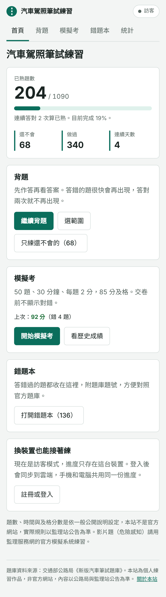
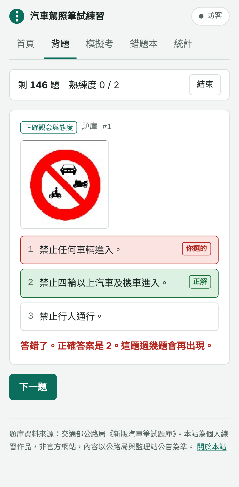
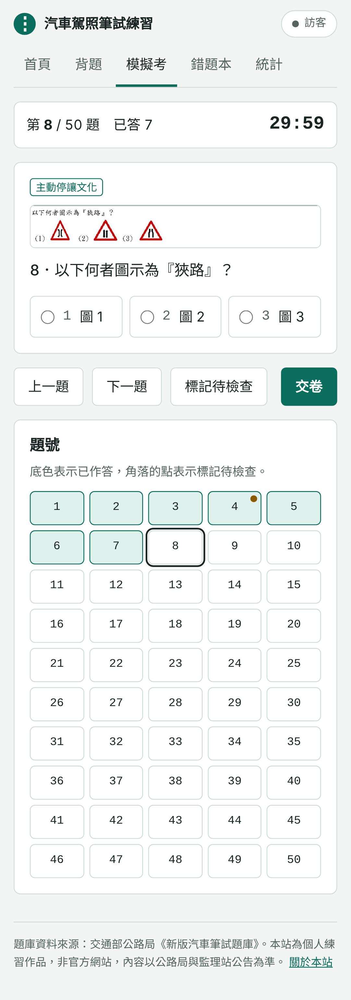
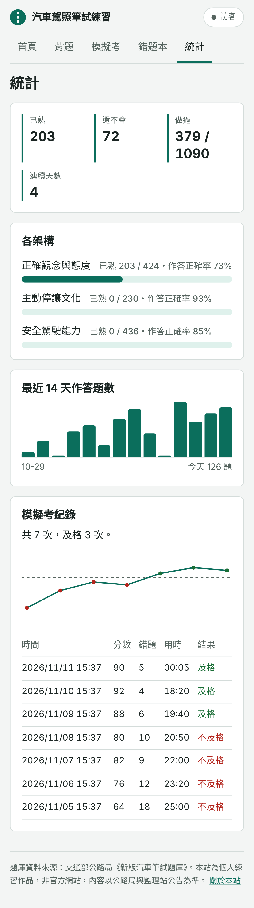
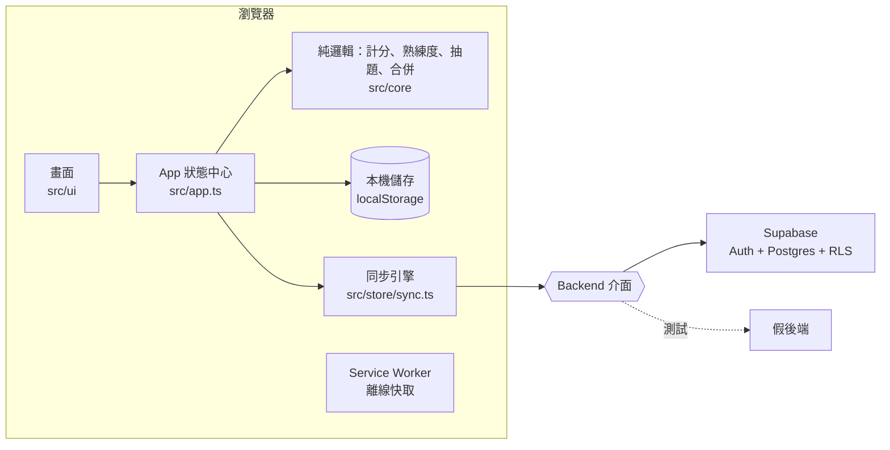

# 汽車駕照筆試練習

用完整的官方題庫背題、考限時模擬考，進度可以跨裝置同步的練習網站。不登入也能完整使用；沒有網路也能用。

> **English summary** — A practice site for Taiwan's car driving-licence written test: all 1,090 official questions (192 with road-sign images), a spaced-repetition study mode, timed mock exams, a wrong-answer book and stats. Local-first: every answer is saved on the device first and synced in the background with per-question last-writer-wins merging, so it works offline and across devices. Static front end (Vite + TypeScript, no UI framework) on GitHub Pages; Supabase (Auth + Postgres + Row Level Security) as the only backend. Unofficial personal project.

| 首頁 | 背題 | 模擬考 | 統計 |
| --- | --- | --- | --- |
|  |  |  |  |

> 本站是個人練習作品，**不是官方網站**。題庫來自交通部公路局公開的《新版汽車筆試題庫》（115.5.29 版），內容以公路局與監理站公告為準。詳見 [NOTICE.md](NOTICE.md)。

## 功能

- **背題**：先作答再看答案。答錯的題隔 4 題再出現，答對一次隔 12 題再出現，連續答對兩次算「已熟」不再出現。可以只練還沒做過的、還不會的、錯題本、看圖題，或依三個架構分開練；可以打亂選項順序，練習記內容而不是記位置。
- **模擬考**：50 題、30 分鐘、每題 2 分、85 分及格。交卷前不顯示對錯，可以標記待檢查的題，時間到自動交卷，重新整理頁面可以接續。
- **錯題本**：答錯過的題依答錯次數排序，附題庫題號，可以匯出文字清單。
- **統計**：各架構的已熟題數與正確率、最近 14 天作答題數、模擬考分數走勢、連續練習天數。
- **帳號**：Google 登入、Email 註冊登入、忘記密碼、刪除帳號與所有資料。登入前用訪客身分練的進度可以併入帳號。
- **同步**：登入後進度自動同步到雲端，手機和電腦共用同一份。離線時的作答會先存在裝置上，恢復連線後補傳。
- **離線與安裝**：開過一次之後沒有網路也能用，可以「加入主畫面」當 App 使用。
- **無障礙**：全程可用鍵盤操作（背題和考試按 1、2、3 作答，模擬考按 ← → 換題），換頁時焦點移到標題，支援深色模式。

考試規則的數字集中在 [`src/config.ts`](src/config.ts)，是依一般公開說明設定的，不是官方保證。正式考試另有危險感知影片題，本站沒有收錄。

## 架構



幾個設計決定：

- **本機優先**。每次作答先寫進本機，畫面馬上反應；上傳在背景進行，失敗就留在「待上傳清單」下次再試。所以沒有網路、後端被暫停、甚至完全沒設定後端，網站都能用。
- **逐題以時間戳合併（Last-Writer-Wins）**。兩台裝置練了同一題，留下較晚作答的那一筆；練了不同的題，兩邊都保留。合併函式是純函式，可交換、可重複執行，有單元測試驗證。同樣的規則也寫成資料庫的 trigger（[`supabase/schema.sql`](supabase/schema.sql)），所以晚到的舊資料不會蓋掉新資料，即使前端有錯也一樣。
- **畫面不直接碰 Supabase**。所有後端操作都經過 [`Backend`](src/backend/types.ts) 介面，有三個實作：Supabase、測試用的假後端、以及「沒有後端」。端對端測試用假後端跑，不需要任何帳號或網路。
- **安全靠資料庫，不靠前端**。前端只有公開的 anon key。每張表都開了 Row Level Security，每個人只能讀寫自己的列；刪除帳號用一個只會刪「呼叫者自己」的資料庫函式。
- **沒有 UI 框架**。畫面用一個 60 行的樣板工具（[`src/ui/dom.ts`](src/ui/dom.ts)），插入的值一律跳脫，題庫文字和 Email 不可能變成可執行的標記。

## 在自己的電腦上跑

需要 Node.js 22 以上。

```bash
npm install
npm run dev            # 訪客模式（沒有後端）
npx vite --mode mock   # 用假後端試註冊、登入、同步（資料只在這個瀏覽器裡）
```

## 架一份自己的（全部免費）

大約 20 到 30 分鐘。步驟 1 到 3 可以跳過，跳過的話網站只有訪客模式。

### 1. 建立 Supabase 專案

1. 到 [supabase.com](https://supabase.com) 註冊，建立一個新專案（免費方案即可）。
2. 左側選單 **SQL Editor** → 新增查詢 → 把 [`supabase/schema.sql`](supabase/schema.sql) 整份貼上 → **Run**。
3. **Project Settings → API**，記下 **Project URL** 和 **anon public** key。

> **絕對不要**把 `service_role` key 放進這個專案或任何前端。這個專案完全用不到它。

### 2. 設定登入

**Authentication → URL Configuration**：

- **Site URL** 填你的網站網址，例如 `https://你的帳號.github.io/driving-test-app/`。
- **Redirect URLs** 加上同一個網址，以及本機開發用的 `http://localhost:5173/`。

驗證信與重設密碼信會把使用者導回這個網址。Supabase 內建的寄信服務有寄送數量限制，只適合測試；要給多人用的話，請在 **Authentication → Emails** 接上自己的 SMTP，或在 **Sign In / Providers → Email** 關閉「Confirm email」（關掉後註冊不需要驗證信，但忘記密碼仍然需要寄信）。

### 2-1. （選用）開啟 Google 登入

1. 到 [Google Cloud Console](https://console.cloud.google.com/) 建立專案，設定 **OAuth 同意畫面**（類型選「外部」）。
2. **API 和服務 → 憑證 → 建立憑證 → OAuth 用戶端 ID**，應用程式類型選「網頁應用程式」。
   - 「已授權的 JavaScript 來源」填你的網站網域，例如 `https://你的帳號.github.io`
   - 「已授權的重新導向 URI」填 `https://你的專案代號.supabase.co/auth/v1/callback`
3. 把產生的「用戶端 ID」和「用戶端密鑰」貼到 Supabase 的 **Authentication → Sign In / Providers → Google**，開啟後儲存。

沒開啟的話，按 Google 按鈕會提示「這個網站還沒開啟 Google 登入」，Email 登入不受影響。

### 3. 本機測試

```bash
cp .env.example .env   # 填入步驟 1 的 URL 與 anon key
npm run dev
```

註冊一個帳號，答幾題，到 Supabase 的 **Table Editor → progress** 應該看得到資料。

### 4. 部署到 GitHub Pages

1. 把這個專案推到 GitHub（分支名稱 `main`）。
2. Repo 的 **Settings → Pages → Build and deployment → Source** 選 **GitHub Actions**。
3. **Settings → Secrets and variables → Actions → Variables** 新增兩個變數：`VITE_SUPABASE_URL`、`VITE_SUPABASE_ANON_KEY`，填你自己專案的值（沒設定的話，會用 workflow 裡原作者專案的預設值）。
4. 推一次 commit，或到 **Actions** 手動執行「測試與部署」。測試通過後會自動部署。

### 免費方案要知道的事

- Supabase 免費專案**閒置一週會被暫停**。暫停時網站仍可用訪客模式，已登入的人作答會留在待上傳清單。到 Supabase 後台按 **Restore project** 就會恢復。
- 免費額度（以 [Supabase 定價頁](https://supabase.com/pricing)為準）對這個用途綽綽有餘：每位使用者最多 1,090 列進度。

## 測試

```bash
npm run typecheck   # 型別檢查
npm test            # 單元測試（52 個）
npm run test:e2e    # 端對端測試（14 個情境 × 手機與桌面，共 28 個）
npm run check       # 以上全部
```

- **單元測試**：計分與及格線、熟練度更新、抽題的均勻性與不重複、打亂選項後正解仍然正確、進度合併的可交換性、兩台裝置的同步情境（離線補傳、同一題衝突、上傳途中又作答）。
- **端對端測試**：訪客背題與重新整理後進度還在、只用鍵盤作答、模擬考全對與交白卷、時間到自動交卷、註冊後第二台裝置看到同一份進度、離線作答後補傳、訪客進度併入帳號、刪除帳號、離線時仍可開啟網站。
- **題庫資料**：每次測試都會檢查 1,090 題的題號連續、每題三個選項、答案合法、附圖檔案存在。

### 題庫有沒有抄錯

`src/data/bank.json` 是用程式從官方 PDF 的表格抽出來的。為了確認沒有抽錯，[`tools/verify_bank.py`](tools/verify_bank.py) 改用另一種獨立的方式（純文字抽取）逐題對照同一份 PDF：

```
題數：1090
答案核對：一致 1090、不一致 0、版面文字中找不到該行 0
文字核對：題幹與選項皆出現在 PDF 中 1090 題、有片段對不上 0 題
```

題庫改版時：下載新的 PDF → 依序執行 `tools/` 裡的 `parse.py`、`split.py`、`crops3.py` → 跑 `verify_bank.py` → 更新 `src/config.ts` 的版本號。這幾支腳本是當初一次性使用的工具，路徑需要自己調整。PDF 本身不要放進 repo。

## 已知限制

- **Supabase 這條路沒有接過真實專案測試。** 同步邏輯與所有流程是用假後端測的，假後端刻意模仿了資料庫的合併規則；但 `src/backend/supabase.ts` 與 `supabase/schema.sql` 本身只做過型別檢查與人工檢視。第一次架站請照「本機測試」那一步實際走一遍註冊、同步、忘記密碼、刪除帳號。
- 合併依賴各裝置自己的時鐘。裝置時間差很多時，「較新」的判斷會不準。資料庫會擋掉超前一天以上的時間戳。
- 同一天在兩台裝置各自練習時，「每日作答題數」取兩者較大值，不是相加。
- 圖片與題目的對應是依 PDF 版面位置判斷的，只抽查過，沒有逐張核對。
- 沒有收錄危險感知影片題。
- 題庫是 115.5.29 版，不會自動更新。
- 進行中的模擬考只存在當下的分頁，關掉分頁就沒了，也不會同步到其他裝置。
- 登入方式只有 Google 與 Email 加密碼。

## 目錄

```
src/core/      純邏輯（沒有瀏覽器相依，全部有單元測試）
src/store/     本機儲存與同步引擎
src/backend/   Backend 介面與三個實作
src/ui/        各頁畫面
src/data/      題庫資料（見 NOTICE.md）
public/        附圖、圖示、Service Worker、manifest
supabase/      資料表、權限、trigger、刪除帳號函式
tests/         單元測試與端對端測試
tools/         從 PDF 產生與核對題庫的腳本
docs/          建置規格與截圖
```

## 授權

程式碼採 [MIT 授權](LICENSE)。題庫資料與附圖的來源和使用條件見 [NOTICE.md](NOTICE.md)。

這個專案是和 AI（Claude）協作完成的：規格、程式、測試與文件由 AI 撰寫，方向、需求與驗收由作者決定。
